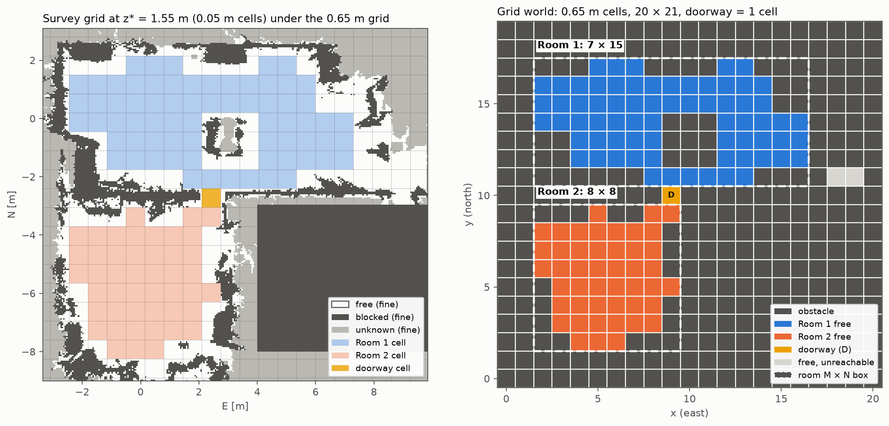

# Step 1: the two-room grid world

A coarse 2-D grid of the lab: every cell is FREE or OBSTACLE, heights ignored, two rooms joined by a one-cell doorway. A statement about
this grid is a statement about one survey-derived map at one altitude, not about the room.



## How it is made

`discretize_lab.py` reads the safenav footprint for the doorway transit
(`ttj/vu-autonomy` `scripts/flights/slices/v6.2-transit-z155-w030-v020/footprint4d.npz`: 0.05 m cells, z* = 1.55 m)
and uses its `free` layer only.

- **Obstacles are over-estimated.** A coarse cell is free only if every 0.05 m cell inside it is free. Blocked,
  unknown and off-map cells all make it an obstacle.
- **The grid offset** is searched: for the requested cell size, the offset with the shortest doorway, then the most
  reachable free area.
- **The doorway is one cell, `D`.** At 0.65 m the door is a one-cell-wide corridor of 5 cells, each of which separates
  the rooms. `D` is the corridor cell nearest the doorway's narrowest point (E 2.475, N -2.70), and every other
  corridor cell goes to the room it stays connected to. (`--cell auto` instead picks the largest size at which the
  door is a single cell: 0.35 m, about 500 free cells. 0.65 m was chosen to keep the networks small to train.)
- **Rooms** are the components holding the map origin (E 0, N 0, floor tag 39) and the room-transit end (E 0.1, N -5.6) once `D` is
  removed. Each room's grid is its bounding box; everything in the box that is not that room's free space is an
  obstacle.

**Coordinates are `(x, y)`: x counts east, y counts north, `(0, 0)` is the south-west cell.** This matches the site
frame (E, N) and ROS REP 103 (ENU). Each room has its
own `(0, 0)` at the south-west corner of its box, and `origin_in_global_xy` places it in the whole-lab grid. The text
grids are printed north-up like a map, so their LAST line is y = 0. `.` free, `#` obstacle, `D` the doorway (whole-lab
grid only).

## Results

Sizes are M rows (y) × N columns (x).

| | M × N | free | box origin in whole-lab `(x, y)` | cell next to `D` (room-local `(x, y)`) |
|---|---|---|---|---|
| whole lab | 20 × 21 | | (0, 0) | |
| Room 1 (big room, column in the middle) | 7 × 15 | 69 | (2, 11) | (7, 0), north of `D` |
| Room 2 (small room) | 8 × 8 | 46 | (2, 2) | (7, 7), south of `D` |

The doorway `D` is whole-lab `(9, 10)`, centre E 2.42 N -2.73. Crossing from Room 1 to Room 2 is two moves south:
Room 1 `(9, 11)` → `D (9, 10)` → Room 2 `(9, 9)`. The other corridor cells went 1 to Room 1 and 3 to Room 2.

- **0.65 m loses floor.** 49 m² of the map's 80 m² of free space is reachable (61 m² at 0.35 m). The east wing of
  Room 1 is cut off: its last two free cells (whole-lab `(18, 11)` and `(19, 11)`) are unreachable and kept as free.
- `cell_size_comparison.png` shows the trade-off between cell size, corridor length and reachable area.

## The flyable region (`flyable.py`, on the flight box)

`room1_flyable.json` holds the Room 1 cells the Neo 2 host would actually fly. A cell's centre must be 0.60 m from
surveyed structure at 1.55 m, and so must every leg between two 4-adjacent cells. It uses the host's own code
(`vu_autonomy_core.freespace.ClearanceMap` from the neo2 checkout's pinned core) and the lab's v6.2 cloud, and records
both. Result: 22 cells reachable from the Neo 2 pad, cell (8, 15) (E 1.47, N 0.64, by floor tag 60), goal (7, 12). It runs on the flight box, where the cloud is:

```
PYTHONDONTWRITEBYTECODE=1 ~/venvs/neo2-flight/bin/python grid/flyable.py
```

## Files

| file | what |
|---|---|
| `discretize_lab.py` | the generator: `~/venvs/vu-flight/bin/python grid/discretize_lab.py [--cell 0.65] [--footprint ...]`, about a minute |
| `lab_grid.py` | the one reader of `lab_grid.json` (standard library only); the networks and tree steps import it |
| `lab_grid.json` | everything: provenance (repo, path, sha256, commit), parameters, whole-lab grid, both rooms (with every free cell as `free_xy`), doorway and corridor, the cell-size search |
| `lab_grid.txt`, `room1_grid.txt`, `room2_grid.txt` | the grids as text |
| `lab_grid.png`, `cell_size_comparison.png` | the figures |
