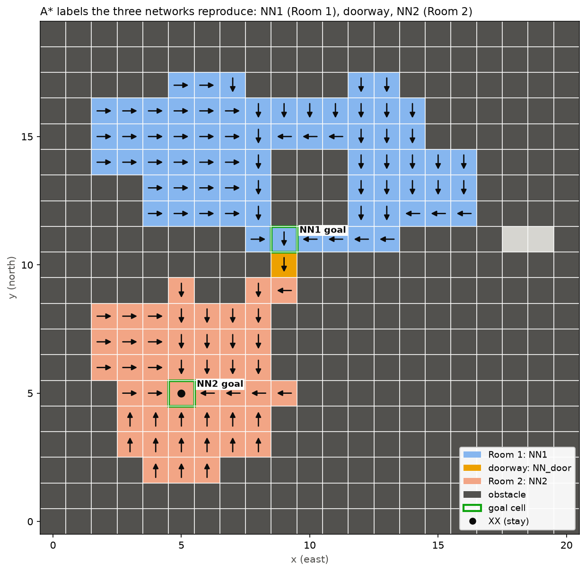

# Step 2: three A* networks

Overfitted A* policies on the 0.65 m two-room grid (`../grid/`), one network per region. The NSBT picks
the network for the region the drone is in, and the network picks the move. Every claim below is about these
networks on this grid, checked exhaustively in python. It is not a model-checking proof, and it is not a statement
about a flight.



| network | region (cells) | goal | label at the goal | layers | min score margin |
|---|---|---|---|---|---|
| `room1.onnx` | Room 1 (69) | `(9, 11)`, directly north of the doorway | `So` (into the doorway) | 2-32-32-5 | 1.28 |
| `door.onnx` | doorway (1) | `(9, 10)` | `So` (into Room 2 at `(9, 9)`) | 2-4-5 | 2.74 |
| `room2.onnx` | Room 2 (46) | `(5, 5)`, the free cell nearest the middle of Room 2's box | `XX` (stay) | 2-32-32-5 | 1.83 |

Coordinates are whole-lab cells `(x, y)`, x east and y north, as in `../grid/lab_grid.json`.

## Interface

The NeuS 2025 grid-world interface, so each network can be declared as a BehaVerify `NEURAL classification` variable:

- **Input:** one float32 tensor `inputs`, shape `[1, 2]`: the drone's whole-lab cell `(x, y)` as raw integers. The
  training scale is folded into the first layer, so nothing has to be normalised before the call.
- **Output:** one float32 tensor `scores`, shape `[1, 5]`, read by argmax in the order `{'We', 'Ea', 'No', 'So', 'XX'}`.
  A tree declares it the same way, for example
  `variable { bl room1 NEURAL classification {'We', 'Ea', 'No', 'So', 'XX'} inputs {x_cur, y_cur} ... }`
  (see `../tree/two_rooms_nsbt.tree`).
- **Layers:** `Gemm` and `Relu` only, the two operations BehaVerify's nuXmv translation accepts for its fixed-point
  strategy. The table strategy accepts any network.

## Labels

A* runs inside the network's own region only: 4-connected, unit cost, Manhattan heuristic. Neighbours are expanded in
the order `No, Ea, So, We`, which fixes A*'s choice between equally short paths. Each label is checked to be an optimal
first move: it lowers the breadth-first distance to the goal by exactly one. The labels and both goals are in `astar_labels.json`.

The networks are trained on every free cell of their region, so no initial set is assumed. They are not trained on
cells outside their region, so their output there means nothing. The tree has to call the right network for the
region, and that is the property the NSBT model has to prove.

## Checks (`training_report.json`)

Each ONNX file is re-read with onnxruntime after export.

- **Accuracy:** on every cell of its region the argmax equals the A* label (69/69, 1/1, 46/46), with the winning score
  at least 1.0 above the runner-up. The margin leaves room for BehaVerify's fixed-point arithmetic.
- **Closed loop:** for every start in all three regions (116 cells), the region's network is applied one move per
  tick. Every run reaches `(5, 5)` and stays there, never entering a cell outside the three regions. The longest run
  from Room 1 is 22 moves.
- **Negative controls:** two broken copies of NN1 must be rejected by the same check, and both are.
  - +3.0 on the `We` score: 9 wrong cells, 20 failed runs, for example a run from `(12, 12)` into the wall at `(11, 12)`.
  - +50 on `XX`: 58 wrong cells, 69 failed runs (the drone stops short in Room 1).
- **The same call BehaVerify's generated python makes** (a plain list of numbers) works on all three files.
- **Training reproduces byte for byte:** rerunning with the same seed gives identical ONNX files.

## Run

```
~/venvs/nsbt/bin/python networks/train_astar_networks.py     # about 10 s on a laptop CPU; exit 0 = every check passed
```

Needs `torch` (CPU is enough), `onnx`, `onnxruntime`, `numpy`, `matplotlib`. Options: `--hidden 32,32`,
`--door-hidden 4`, `--margin 1.0`, `--seed 0`, `--grid <lab_grid.json>` (default `../grid/lab_grid.json`).
